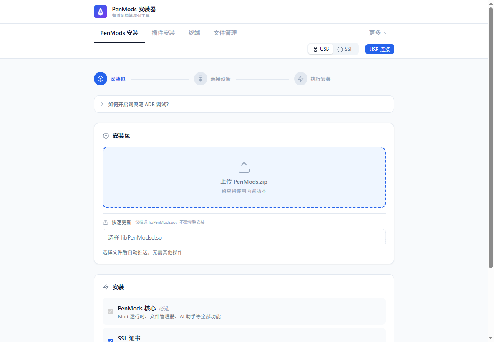
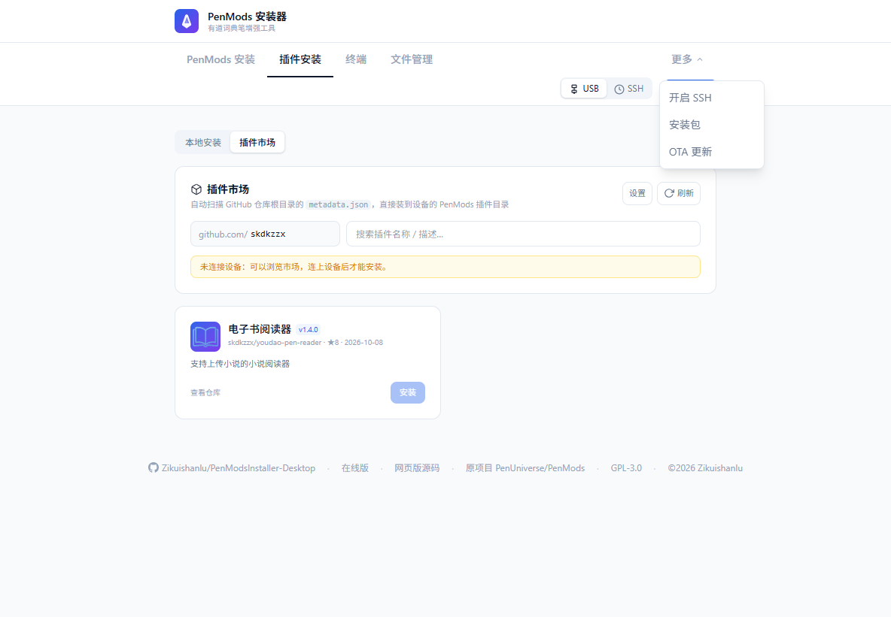
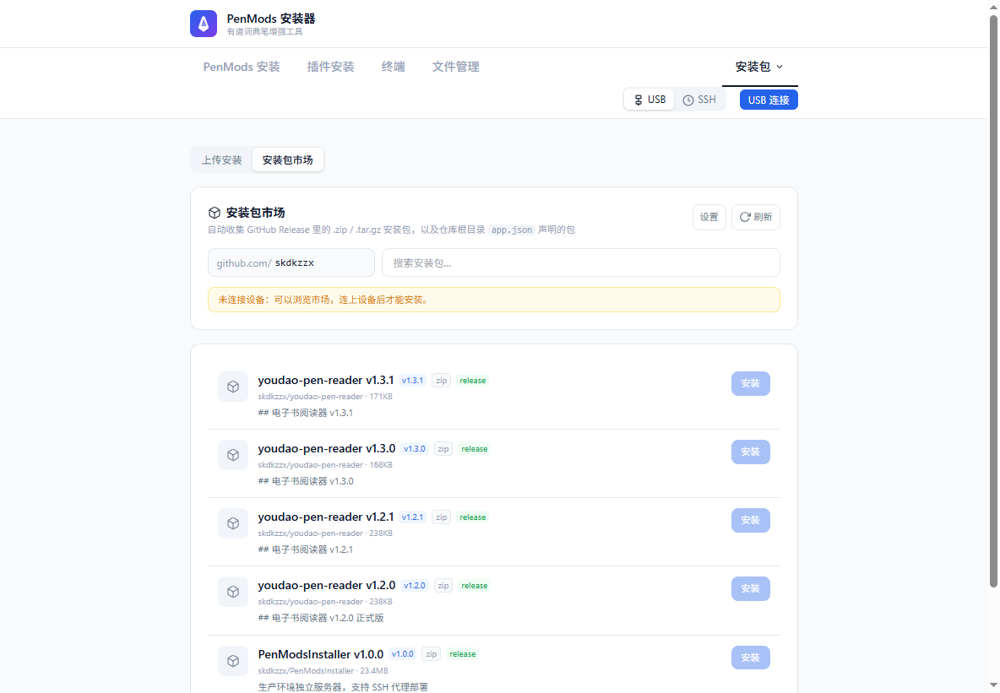
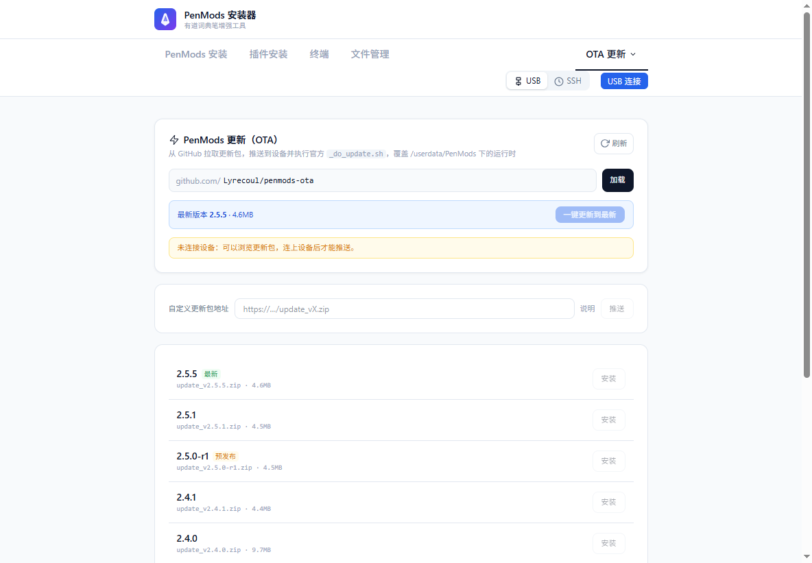

# PenMods 安装器（桌面版）

把 [pen.skdkzzx.dpdns.org](https://pen.skdkzzx.dpdns.org/) 的网页版安装器做成 Windows 桌面程序，
并在原版基础上加了三个市场/更新功能。

- 本项目源码：<https://github.com/Zikuishanlu/PenModsInstaller-Desktop>
- 在线版：<https://pen.skdkzzx.dpdns.org/>
- 网页版源码（本项目上游）：[skdkzzx/PenModsInstaller](https://github.com/skdkzzx/PenModsInstaller)
- 上游内核：[PenUniverse/PenMods](https://github.com/PenUniverse/PenMods)
- 许可证：**[GPL-3.0](LICENSE)**（分发时请附上源码，见 [docs/NOTICE.md](docs/NOTICE.md)）
- 遇到问题或想交流：见下方 [问题反馈与技术交流](#问题反馈与技术交流)（QQ `3876655271` / 邮箱 `3876655271@qq.com`）

## 二开声明（Derivative Work）

**本项目是「二开」项目，不是原创作品。** 维护者：**Zikuishanlu**，但版权与设计归属如下：

| 部分 | 归属 |
| --- | --- |
| 网页版本体（`skdkzzx/PenModsInstaller`：界面、安装流程、USB/SSH 逻辑） | [skdkzzx](https://github.com/skdkzzx/PenModsInstaller) |
| 设备端内核 PenMods（`libPenMods.so` 等） | [PenUniverse/PenMods](https://github.com/PenUniverse/PenMods) |
| OTA 更新包 | [Lyrecoul/penmods-ota](https://github.com/Lyrecoul/penmods-ota) |
| 桌面封装 + 三个市场/更新页面 + 品牌与文案调整 | Zikuishanlu（本仓库） |

本仓库做的事只有三件：① 把网页版封装成 Windows 桌面程序（Electron 外壳 + 本地 HTTP/WS 服务，见 [实现原理](docs/IMPLEMENTATION.md)）；
② 新增「插件市场 / 安装包市场 / OTA 更新」三个页面；③ 品牌与文案调整。

依 GPL-3.0 分发，原始版权声明完整保留（见 [LICENSE](LICENSE)、[docs/NOTICE.md](docs/NOTICE.md)）。
若要基于本项目继续修改，同样需要开源，并保留上述所有归属声明。

想搞懂「为什么在浏览器里也能给词典笔装东西」：
👉 **[实现原理详解](docs/IMPLEMENTATION.md)**（WebUSB + ADB、SSH 代理、安装命令链、三项市场机制）

| 功能 | 位置 | 数据来源 |
| --- | --- | --- |
| 插件市场（在线浏览 + 一键安装插件） | 插件安装 → **插件市场** | 你的 GitHub 仓库（默认 `skdkzzx`，可改） |
| 安装包市场（在线浏览 + 一键安装应用包） | 安装包 → **安装包市场** | 同上：仓库的 Release 附件或 `app.json` |
| PenMods 运行时 OTA 更新 | 更多 ⋯ → **OTA 更新** | `Lyrecoul/penmods-ota` 的 `update_*.zip` |


原来网页版的所有能力都保留：PenMods 安装/卸载、插件本地安装、终端（shell）、文件管理、开启 SSH。



| 插件市场 | 安装包市场 | OTA 更新 |
| --- | --- | --- |
|  |  |  |


## 下载

不想自己编译就直接下现成的 exe：

| 文件 | 说明 |
| --- | --- |
| [PenMods-Installer-Portable-1.0.0.exe](https://github.com/Zikuishanlu/PenModsInstaller-Desktop/releases/download/v1.0.0/PenMods-Installer-Portable-1.0.0.exe) | 免安装单文件，双击即用 |
| [PenMods-Installer-1.0.0-x64.exe](https://github.com/Zikuishanlu/PenModsInstaller-Desktop/releases/download/v1.0.0/PenMods-Installer-1.0.0-x64.exe) | 安装版，可选目录 + 桌面快捷方式 |

全部版本在 [Releases](https://github.com/Zikuishanlu/PenModsInstaller-Desktop/releases) 页面。
程序未做代码签名，Windows 可能提示「未知发布者」，选「仍要运行」即可。

## 问题反馈与技术交流

安装失败、功能有 bug、想加东西，或者只是想聊聊词典笔怎么折腾，都欢迎直接找我：

- **QQ**：`3876655271`（加好友请备注「PenMods」，方便我分辨）
- **邮箱**：[3876655271@qq.com](mailto:3876655271@qq.com)
- **GitHub Issues**：<https://github.com/Zikuishanlu/PenModsInstaller-Desktop/issues>

选择渠道的建议：

| 情况 | 去哪说 |
| --- | --- |
| 装不上、报错、疑似 bug | **优先开 Issue**：附上日志和机型，别人也能搜到答案，不用重复问 |
| 想加功能、改文案、提体验建议 | Issue 或 QQ / 邮箱都可以 |
| 自己写的插件或安装包没出现在市场里 | 带上仓库地址找我，多半是 `metadata.json` / `app.json` 放错了位置 |
| 纯聊天、问点零碎问题 | QQ 最直接，回复也快 |

为了让问题一次说清，反馈时顺手带上这几样：

1. 机型与固件版本（如 YDP02x / YDPG3）
2. 连接方式：USB 还是 SSH
3. 卡在哪一步（截图或界面上的日志原文最好）
4. 已经试过什么

我会尽量当天回；如果只是加功能的需求，可能会慢一点，但都会看。

## 为什么做成桌面程序

网页版连设备靠 **WebUSB**，只有 Chromium 内核的桌面壳能完整保留这条通道；
同时桌面版内置了本地服务（`http://127.0.0.1:47821`，端口被占用时自动换随机端口），
顺带解决了三件事：

- **SSH over WebSocket** 代理（原版靠 vite 插件 / server.mjs，桌面版内置）
- **GitHub API 代理** `/api/gh`：绕开 CORS，可注入 Personal Access Token 提高限额
- **下载代理** `/api/dl`：白名单域名 + `Range` 断点续传（大文件网络抖动时自动续，不用从头再来）

应用自身没有任何后端依赖，离线也能装 PenMods（安装文件已随程序打包）。

## 开发与构建

```bash
cd app
npm install          # 若 npm 报 edgesOut 之类的 peer 解析错误，改用 --legacy-peer-deps
npm run build        # vite 构建前端到 app/dist
npm start            # 用 Electron 直接跑起来（会启动内置本地服务）
```

## 打包 exe

```bash
cd app
npm run dist           # 产出安装版 NSIS：PenMods-Installer-<版本>-x64.exe
npm run dist:portable  # 产出免安装单文件：PenMods-Installer-Portable-<版本>.exe
```

产物在 `app/release/`。图标：`app/build/icon.ico`（由 `app/tools/make_icon.py` 生成）。

当前这次构建出来的成品（都已实际启动验证）：

| 文件 | 大小 | 说明 |
| --- | --- | --- |
| `app/release/PenMods-Installer-Portable-1.0.0.exe` | ~109 MB | 免安装单文件，双击即用（解压到临时目录运行） |
| `app/release/PenMods-Installer-1.0.0-x64.exe` | ~118 MB | NSIS 安装版，可选安装目录，建桌面/开始菜单快捷方式 |

> 打包时 electron-builder 需要下载 Electron 二进制与 NSIS 工具链；`.npmrc` 已把
> `electron_mirror` / `electron_builder_binaries_mirror` 指向 npmmirror 镜像。
> 网络差的环境可以先把 `electron-v<版本>-win32-x64.zip` 放到
> `%LOCALAPPDATA%\electron-builder\Cache\electron\`，再执行 `npm run dist:portable`。

> 注意：`electron-builder` 的 asar 完整性校验会去解析已签名的 `electron.exe`，
> 在 `pe-library` 上会抛 `Parsing signed executable binary is not allowed`；
> 配置里已设 `"disableAsarIntegrity": true` 规避。

## 双击没反应怎么办

1. **别把 exe 放在项目目录里**。本机实测：放在工作区目录（`...\dsh\penmods\...`）下的 exe
   双击后进程秒退、窗口不出现；同样的文件复制到桌面就能正常跑。
   把 `PenMods-Installer-Portable-1.0.0.exe` 放到桌面或 `D:\` 这类普通目录再双击。
2. 看启动日志：`%TEMP%\penmods-installer-boot.log`。
   - 文件不存在 → 主进程还没跑到 JS 就退出了（基本就是路径/杀软拦截，换目录重试）。
   - 有 `app ready` 但没 `window created` → 本地服务或窗口创建失败，日志里会写原因。
3. 打包后确认 `resources/app.asar` 完整：
   ```bash
   node -e "const a=require('@electron/asar');const f=a.listPackage('app/release/win-unpacked/resources/app.asar');console.log(f.length, f.some(x=>x.includes('dist/index.html')))"
   ```
   正常输出 `1382 true`；若是 `false`，说明这次 asar 里丢了 `dist/`、`electron/`、`package.json`
   （典型场景是上一次打包被中断、机器蓝屏后再打包）。删掉 `app/release/win-unpacked` 重跑
   `electron-builder` 即可，打出来的 exe 会立刻能启动。


## 插件市场怎么认插件

扫描指定账号下的仓库，命中以下任意一处即认为是一个插件：

- 仓库根目录的 `metadata.json`
- 一级子目录 `plugin/`、`plugins/`、`src/`、`app/`、`source/` 里的 `metadata.json`（跳过「源码」目录）

`metadata.json` 示例（`skdkzzx/youdao-pen-reader`）：

```json
{
  "id": "com.reader.novel",
  "name": "电子书阅读器",
  "version": "1.4.0",
  "author": "skdkzzx",
  "description": "支持上传小说的小说阅读器",
  "icon": "file://userdisk/PenMods/plugins/novel-reader/icon.png",
  "main_qml": "main.qml",
  "main_so": "libshell_plugin.so"
}
```

安装目录名依次取：`icon` 里的 `plugins/<名字>/` → `id` 最后一段 → 仓库名。
所以**想控制装到哪个目录，就把 `icon` 写成 `.../plugins/<你要的目录名>/icon.png`**。

## 安装包市场怎么发布

两种都支持，扫描时优先 Release 附件：

1. **GitHub Release 附件**：附上 `.zip` / `.tar.gz` / `.tgz`（>200MB 会跳过）
2. **仓库根目录 `app.json`**：

```json
{
  "id": "my-app",
  "name": "我的应用",
  "version": "1.0.0",
  "description": "做什么用的",
  "author": "skdkzzx",
  "archive": "https://github.com/.../app.zip",
  "installScript": "https://raw.githubusercontent.com/.../install.sh",
  "icon": "https://raw.githubusercontent.com/.../icon.png"
}
```

安装时会：推包到 `/userdisk` → 解压 → 若有 `install.sh` 就执行 → 清理。

## OTA 更新

读取 `Lyrecoul/penmods-ota` 根目录的 `update_*.zip`，按版本号排序，最新版可一键更新。
设备端流程（与官方 `template/_do_update.sh` 对齐）：

1. `mount -o remount,rw /`
2. 推送 zip 到 `/userdisk/__penmods_ota.zip`，解压到 `/userdisk/__penmods_ota`
3. `find` 找到 `_do_update.sh`，**cd 到它所在目录**再执行（脚本用 `pwd` 当内容目录）
4. 校验 `INSTALL_SUCCESSFULLY` 标记，删掉临时文件
5. 建议重启设备让新的 `libPenMods.so` 生效（页面里有「重启设备」按钮）

若压缩包里没有 `_do_update.sh`，会退化成直接把 `libPenMods.so` /
`libPenModsResources.so` 复制到 `/userdata/PenMods`（2.4.0+ 两个库必须一起换）。

OTA 源仓库可以在页面里改，也支持贴任意 zip 直链。

## GitHub Token（可选但推荐）

匿名调用 GitHub API 每小时 60 次，扫市场很快就用完。在「插件市场 / 安装包市场 → 设置」
里填入 Personal Access Token（只需 public_repo 读权限）即可提到 5000 次/小时。
Token 只存在本机 localStorage，由主进程转发时加在请求头里。

## 目录结构

```
app/
  electron/
    main.cjs      主进程：窗口、WebUSB 权限、启动本地服务
    preload.cjs   仅暴露 isDesktop / openExternal
    server.cjs    本地 HTTP + /ws/ssh + /api/gh + /api/dl
  src/
    lib/github.ts         GitHub API、断点续传下载
    lib/market.ts         仓库扫描 → 插件/安装包清单
    lib/market-install.ts 市场包 → 设备安装（含 OTA 脚本）
    pages/PluginMarket/   插件市场
    pages/AppsMarket/     安装包市场
    pages/OtaPage/        OTA 更新
    pages/hubs.tsx        本地安装 / 市场 的分段切换
  public/files/           PenMods 安装文件（79 个，随程序打包）
  build/icon.ico          应用图标
  src/lib/branding.ts     品牌/链接集中配置（换成自己的信息只改这里）
docs/
  IMPLEMENTATION.md       实现原理详解（WebUSB/ADB、SSH 代理、安装链、市场机制）
  NOTICE.md               开源协议与来源声明、修改说明、第三方组件
screenshots/              界面截图
```

## 第一次推送到 GitHub

本仓库已初始化并完成首个提交（分支 `main`），远程地址已设为
`git@github.com:Zikuishanlu/PenModsInstaller-Desktop.git`。

```bash
git push -u origin main
```

前提是：

1. GitHub 上已建好空仓库 `PenModsInstaller-Desktop`（不要勾选自动生成 README/LICENSE）；
2. 本机 SSH 公钥已加到该账号（`ssh -T git@github.com` 应返回 `Hi <用户名>!`）。

用 HTTPS 也行，把远程换成 `https://github.com/Zikuishanlu/PenModsInstaller-Desktop.git` 即可。

## 自动构建（可选）

仓库带了一个 GitHub Actions 工作流 `.github/workflows/build.yml`：

- 手动触发（Actions → build → Run workflow）会跑一遍类型检查 + 打包，产物在 Artifacts 里；
- 打 tag（`git tag v1.0.0 && git push origin v1.0.0`）会自动把两个 exe 传到 Release。

这样换台机器、或者本机网络抽风时，也能拿到可用的 exe。

## 开源协议（重要）

本项目以 **GPL-3.0** 发布，因为它派生自同样使用 GPL-3.0 的两个项目：

- [skdkzzx/PenModsInstaller](https://github.com/skdkzzx/PenModsInstaller) —— 界面与安装逻辑（直接上游）
- [PenUniverse/PenMods](https://github.com/PenUniverse/PenMods) —— 设备端内核 `libPenMods.so` / `patch.sh` / `misc/*`

如果你把这个程序（包括打包出来的 exe）转发给别人，GPL-3.0 要求你：

1. 附上 [LICENSE](LICENSE) 全文；
2. **同时提供完整源码**（就是你基于本仓库改出来的那份，不能只给 exe）；
3. 说明你改了什么（在 [docs/NOTICE.md](docs/NOTICE.md) 第 3 节追加即可）；
4. 保留原作者版权与免责声明；
5. 不得把它改成闭源专有软件再分发。

第三方组件（React、@yume-chan/adb、jszip、ssh2、xterm 等）均为 MIT 许可，清单与版本见
[docs/NOTICE.md](docs/NOTICE.md) 第 4 节。

## 免责声明

刷机有风险。装之前先确认机型与固件版本，出错可用原版恢复流程救回。
完整条款（含风险提示、与网易有道无关联声明）见 [docs/NOTICE.md](docs/NOTICE.md) 第 5 节。

